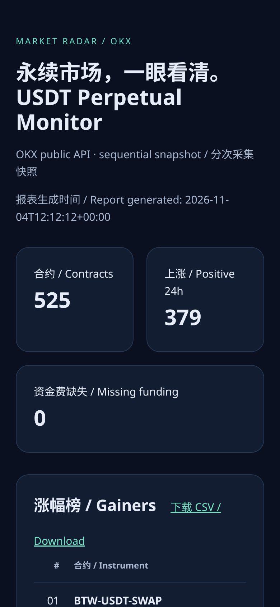
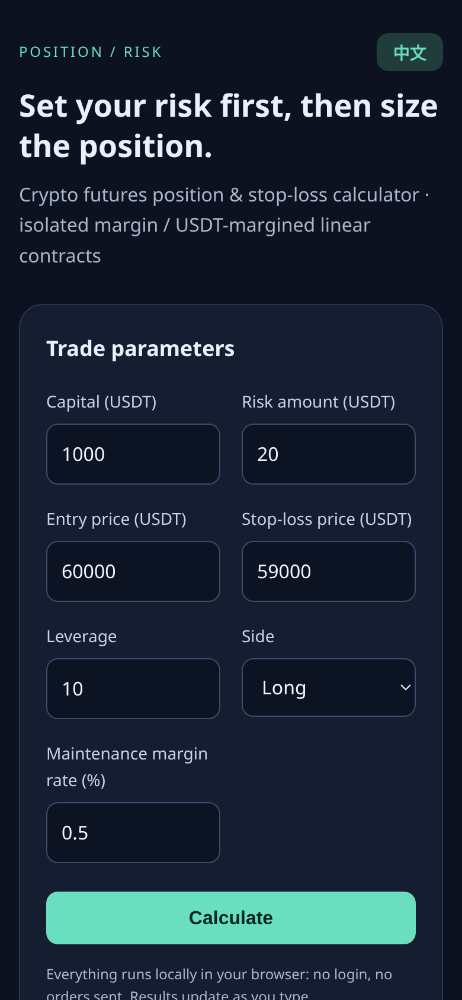

# Portfolio — Python Automation, Bots & Web Tools

Three small, production-minded projects: a market-data scraper, a Discord bot and a browser-based risk calculator. Each one runs on its own, has tests and documents its limits honestly.

| Project | What it shows | Try it |
| --- | --- | --- |
| [Crypto Scraper](crypto-scraper/README.md) | Pulls every OKX USDT perpetual (500+ contracts) in about a second, ranks them and exports CSV + a mobile-friendly HTML report. Standard library only, with retries and offline mode. | [Live report](https://raw.githack.com/loongw320-alt/portfolio/main/crypto-scraper/examples/report.html) |
| [Discord Bot](discord-bot/README.md) | Slash commands for prices and persistent price alerts (`/price`, `/alert`, `/alerts`, `/cancel`), member welcomes and whole-word keyword moderation. | [Source](discord-bot/bot.py) |
| [Position Calculator](position-calc/README.md) | Futures position sizing, stop-loss risk and isolated liquidation estimates. Zero dependencies, English/中文. | [Open calculator](https://raw.githack.com/loongw320-alt/portfolio/main/position-calc/index.html) |

## Screenshots (mobile, 390×844)

<p>

&nbsp;

</p>

## Quick start

Requires Python 3.10+. From the repository root:

```sh
python3 crypto-scraper/scraper.py --output /tmp/okx-report             # live OKX data, ~1s, no API key
python3 crypto-scraper/scraper.py --offline market.json --output /tmp/offline-report
python3 -m pytest crypto-scraper/tests discord-bot/tests               # or: python3 -m unittest discover -s <project>/tests
```

Open `position-calc/index.html` in any browser. Running the Discord bot needs `pip install -r discord-bot/requirements.txt` and your own bot token; see its README. The tests run fully offline.

The bundled scraper report is a real live OKX run from 2026-11-04 (525 USDT perpetuals). It is a point-in-time snapshot and does not auto-update. `market.json` is a 30-row offline sample used for network-free demos and tests.

---

## 中文简介

三个可独立运行的小项目：行情爬虫（OKX 全部 USDT 永续，约 1 秒完成，输出 CSV 和手机友好的 HTML 报表）、Discord 行情提醒机器人（`/price` `/alert` `/alerts` `/cancel`、欢迎新人、整词关键词过滤）、仓位与止损计算器（中英双语，纯本地计算）。运行方式见上方命令和各项目 README。爬虫示例是 2026-11-04 的真实在线数据快照，不会自动更新。
